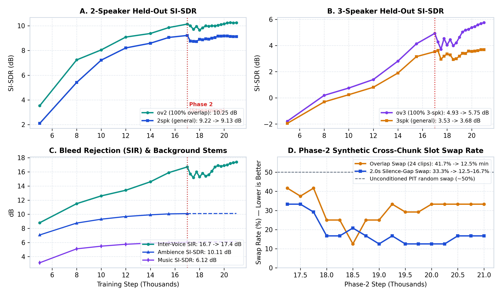
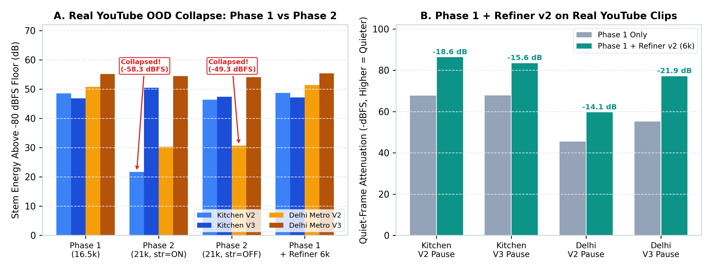
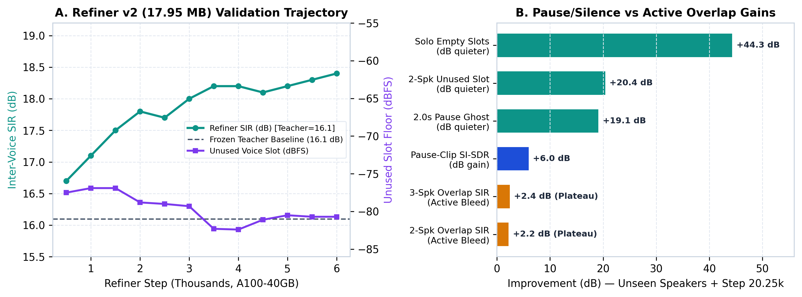
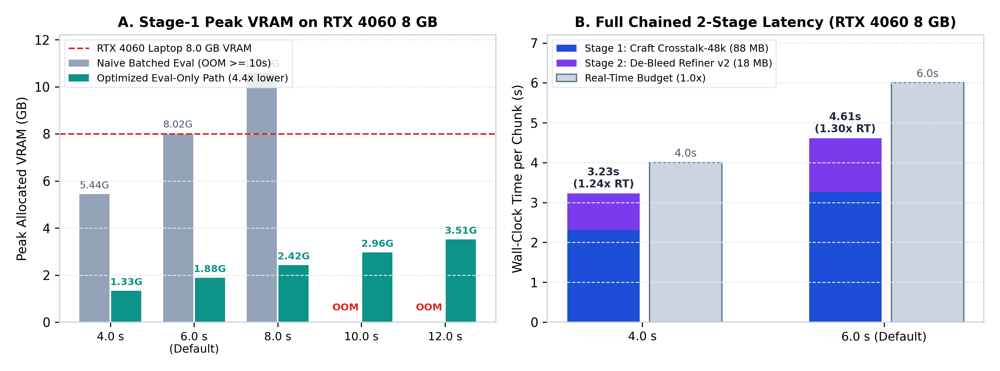

# Craft Crosstalk-48k (`HarmonicSlot-TF v3` + Full-Bin De-Bleed Refiner)

[](LICENSE)
[](WEIGHTS_LICENSE.md)
[](paper/Craft_Crosstalk_48k_Paper.pdf)

**Single-pass 48 kHz stereo 5-stem neural audio separation (`Voice 1`, `Voice 2`, `Voice 3`, `Music`, `Ambience`) with 4.4× VRAM-optimized ComfyUI nodes (1.88 GB peak VRAM on an RTX 4060 8 GB laptop GPU) and an honest empirical analysis of streaming slot collapse & full-bin post-filtering.**

📄 **Read the Full Technical Paper:** [Craft_Crosstalk_48k_Paper.pdf](paper/Craft_Crosstalk_48k_Paper.pdf) | [arXiv LaTeX Source](paper/main.tex)

---

## Why This Project Exists

Open-source neural audio separation is split into two incompatible worlds:
- **Music separators** (HTDemucs, BS-RoFormer) run at 44.1–48 kHz stereo but merge all overlapping speakers into one vocal track.
- **Speech separators** (SepFormer, TF-GridNet, MossFormer2) split 2–3 talkers on 8–16 kHz mono audio but throw away 48 kHz stereo music and room ambience.

**Craft Crosstalk-48k** (`46.13M` params, `88.0 MB bf16`) separates **3 overlapping voices + Music + Ambience in a single 48 kHz stereo pass** locally on consumer 8 GB GPUs (`3.26s` per `6.0s` stereo chunk on an RTX 4060 Laptop — `1.84×` faster than real-time).

---

## Published Checkpoints (GitHub Releases)

Download all checkpoints from the **[Releases](../../releases)** tab and place them into `ComfyUI/models/audiosep/audiosep_48k/`:

| Checkpoint | Size (`bf16`) | Purpose & Honest Recommendation |
|---|---:|---|
| **`craft_crosstalk_48k_phase1_step17000.safetensors`** ⭐ | `88.0 MB` | **Recommended Stage 1** — `9.22 dB` 2-spk, `10.14 dB` ov2, `16.7 dB` SIR, `6.03` Music, `10.09` Amb. Cleanly splits real-world YouTube audio without slot collapse. |
| **`craft_crosstalk_48k_phase2_step21000.safetensors`** 🔬 | `88.0 MB` | **Research Checkpoint (Phase 2 Streaming)** — Best synthetic held-out metrics (`5.75 dB` ov3, `17.4 dB` SIR, `16.7%` 2s-gap swap), published openly so researchers can reproduce our documented out-of-domain real-world single-slot collapse finding. |
| **`craft_debleed_refiner_v2_step6000.safetensors`** | `17.95 MB` | **Optional Stage-2 Full-1,025-Bin Refiner** — Cuts pause ghost bleed by **`-19.1 dB`** (`+5.97 dB` pause-clip SI-SDR), solo empty slots to **`-118.9 dBFS`**, and vocal bleed in Music/Ambience by **`35–42%`**. *(Honest note: plateaus at `+2.2–2.4 dB` SIR on 100% simultaneous overlap.)* |

---

## Key Results & Honest Empirical Findings

### 1. Held-Out Unseen Speakers (48 kHz Stereo, 50% Dual-Mono)


### 2. Honest Negative Finding #1 — Phase-2 Out-of-Domain Collapse vs Phase 1
Although Phase 2 (`step 21k`) beat Phase 1 on every synthetic metric, real 128 kbps YouTube shouting clips (*Kitchen Nightmares*, *Delhi Metro Fight*) exposed severe **single-slot collapse** in Phase 2 (`V2 = -58.3 / -49.3 dBFS`), while **Phase 1 cleanly split both speakers** — and chaining Refiner v2 after Phase 1 cut quiet-frame bleed by `-14.1` to `-21.9 dB` and reduced `V2–V3` crosstalk correlation by `56%` (`0.303 → 0.132`).



### 3. Honest Negative Finding #2 — Pause/Background vs Simultaneous Active Overlap


### 4. Local RTX 4060 8 GB Performance (4.4× VRAM Reduction)


---

## ComfyUI Quickstart (Plug & Play)

1. Copy the `ComfyUI-HarmonicSlotTF/` folder into `ComfyUI/custom_nodes/ComfyUI-HarmonicSlotTF/`.
2. Download the `.safetensors` checkpoints from **[Releases](../../releases)** into `ComfyUI/models/audiosep/audiosep_48k/`.
3. Restart ComfyUI and load [`workflows/Craft_Crosstalk_48k_DeBleed.json`](workflows/Craft_Crosstalk_48k_DeBleed.json).
4. Four custom nodes are included under `audio/separation`:
   - `HarmonicSlotTF Loader` & `HarmonicSlotTF Separate (5-Stem)`
   - `Craft Crosstalk De-Bleed Loader` & `Craft Crosstalk De-Bleed Refiner (5-Stem)`

---

## Support Independent Open-Source Audio Research (Fund `v4`)

This entire project — dataset auditing, 48 kHz architecture, 4.4× VRAM optimization, ComfyUI nodes, and honest failure analysis — was developed independently without institutional GPU grants.

**Our next goal (`Craft Crosstalk-48k v4`) is solving the hardest remaining problem: true simultaneous active-overlap crosstalk elimination on real-world YouTube/film audio (100% open & commercially clean CC0/CC-BY weights):**
- **Milestone 1 (`$50`):** 1,000+ diverse CC0/CC-BY speakers (shouting, arguments, emotional speech) + Slakh2100/Freesound CC0 + live MP3/AAC/Opus codec & camera-mic augmentation.
- **Milestone 2 (`$150`):** Full-resolution `>4.6 kHz` band splits + TF-GridNet-style cross-frequency harmonic attention trained specifically on active simultaneous overlap (not pause gating).
- **Milestone 3 (`$250`):** Complete `v4` A100 training + external pretrained neural speaker verification (`WavLM-SV`) chunk locking for zero-swap, zero-collapse multi-minute separation.

If this research, codebase, or ComfyUI plugin helps you, please consider supporting continued GPU compute:
- **GitHub Sponsors / Ko-fi / BuyMeACoffee:** *(Add your sponsor link here)*
- **Contact / Collaboration:** `sachipoonga@gmail.com`

---

## Citation

```bibtex
@misc{craftcrosstalk48k2026,
  title  = {Craft Crosstalk-48k (HarmonicSlot-TF v3): Unified Single-Pass 48 kHz Stereo Multi-Voice, Music, and Ambience Separation with Consumer-GPU Inference and Empirical Analysis of Streaming Collapse and Full-Bin Post-Filtering},
  author = {Independent Open-Source Audio Research (storytold)},
  year   = {2026},
  howpublished = {\url{https://github.com/storytold/Craft-Crosstalk-48k}}
}
```

## License
- **Code, Training Scripts, & ComfyUI Nodes:** [MIT License](LICENSE)
- **Research Model Weights (`.safetensors`):** [CC BY-NC-SA 4.0](WEIGHTS_LICENSE.md) (due to MUSDB18-HQ, OpenSLR 68, and OpenSLR 103 non-commercial clauses; raw training audio is never redistributed).
